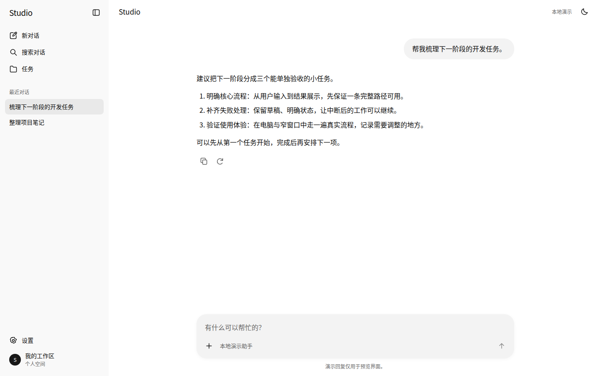
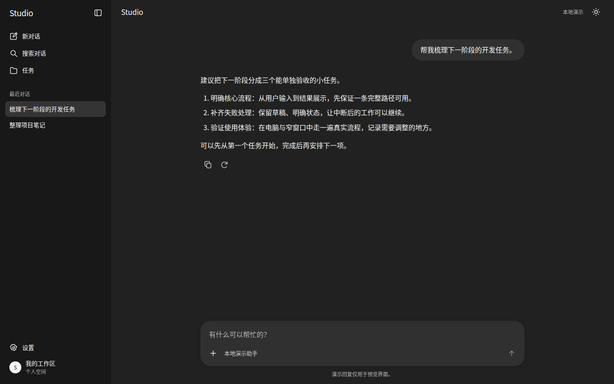

# ChatGPT 风格前端设计

为 AI 编程助手提供一套可执行的前端设计规范，让网页和桌面软件在颜色、字体、布局、按钮、图标与交互上保持清晰、克制的 ChatGPT 风格。

**技能名称：** `chatgpt-ui-design`

**显示名称：** ChatGPT 风格前端设计

这个 README 面向使用者；AI 执行任务时的主要指令位于 [SKILL.md](SKILL.md)。

## 风格预览

以下是本技能配套参考界面的实际运行截图，展示中性色、文字层级、侧栏、消息排版、输入框和单色图标。实际项目会根据业务内容与平台调整布局。

**浅色主题**



**深色主题**



## 能做什么

- 新建或改造网页、AI 助手、工具软件、任务管理页、工作区、列表、设置和表单。
- 统一浅色、深色及跟随系统主题，处理字体、文字层级、间距、圆角、按钮和单色线性图标。
- 适配网页及 Electron／Tauri 应用，并为 Qt／PySide、WPF、Flutter、SwiftUI 等原生界面提供映射方法。
- 要求 AI 保留已有功能与技术栈，运行软件、检查截图和关键交互后再交付。

这套规范适用于不同业务页面。列表和设置页会保留各自的信息结构，聊天界面只是其中一种布局。

## 快速使用

### 在支持 Skills 的工具中使用

按所用工具的安装方式导入完整的 `chatgpt-ui-design` 文件夹。技能被工具发现后，在技能列表中选择「ChatGPT 风格前端设计」，或使用该工具支持的技能调用方式。

以下内容是发给 AI 的提示词：

```text
$chatgpt-ui-design 按照这套规范改造当前项目的界面，保留原有功能和技术栈，完成后运行并截图验收。
```

`$chatgpt-ui-design` 是否会被识别，取决于工具是否支持该语法，以及技能是否已被加载。

### 直接让 AI 读取文件

如果工具没有技能选择器，也可以让能够访问项目文件的 AI 明确读取技能。将下例中的路径替换为实际位置：

```text
请读取 D:\Skills\chatgpt-ui-design\SKILL.md，并按其中要求读取相关规范和资源。
随后改造当前项目的前端：保留业务功能、路由和技术栈，统一浅深色主题、字体、布局、按钮及图标。
完成后运行项目，检查实际截图和关键交互，并说明验证结果。
```

保留 `references/`、`assets/` 与 `scripts/` 的相对目录结构，便于 AI 找到规范和配套资源。

## 提示词示例

**改造已有软件**

```text
使用 $chatgpt-ui-design 重做当前软件的界面。
先查看现有工程并运行，保留功能和数据逻辑，重点改善侧栏、内容布局、按钮、表单和设置页。
支持浅色与深色，完成后给出启动方式和实际检查结果。
```

**制作普通任务管理页**

```text
使用 $chatgpt-ui-design 制作文件转换任务管理页。
需要任务列表、搜索、状态筛选、任务详情和外观设置，先使用明确标识的本地演示数据。
```

**改造原生桌面软件**

```text
使用 $chatgpt-ui-design 改造现有 PySide6 软件的主窗口和设置页。
保留 PySide6 和业务逻辑，统一浅深色、控件、图标与窗口布局。
请使用原生主题映射，说明已经运行验证和暂时无法验证的部分。
```

**限定修改范围**

```text
使用 $chatgpt-ui-design，只调整当前页面的工具栏、按钮和输入框。
保留已有导航、页面结构和品牌橙色，补齐悬停、焦点、禁用和加载状态。
```

## 目录与文件说明

| 文件或目录 | 用途 |
| --- | --- |
| [README.md](README.md) | 给使用者阅读的用途与操作说明 |
| [SKILL.md](SKILL.md) | 技能的能力描述、使用时机、执行流程与约束 |
| [agents/openai.yaml](agents/openai.yaml) | 支持该配置的平台使用的显示名称、简介、图标、默认提示与调用策略 |
| [assets/tokens.css](assets/tokens.css) | 颜色、字体、间距、圆角等设计变量的数值来源 |
| [assets/primitives.css](assets/primitives.css) | 以 `.cg-app` 为作用域的基础组件样式 |
| [assets/icons.svg](assets/icons.svg) | 配套的单色线性工具图标 |
| [assets/icon.svg](assets/icon.svg) | 技能在支持图标的平台中的展示标识 |
| [assets/preview-light.png](assets/preview-light.png)、[assets/preview-dark.png](assets/preview-dark.png) | README 中使用的浅色与深色界面截图 |
| [assets/reference.html](assets/reference.html) | 可运行的界面参考，配合 `reference.js`、CSS 和 SVG 使用 |
| [references/](references/) | 视觉、组件、布局、平台、交互和验收规范 |
| [scripts/export_theme.py](scripts/export_theme.py) | 导出 JSON、Qt QSS 或 WPF XAML 主题资源 |
| [scripts/check_tokens.py](scripts/check_tokens.py) | 检查配套颜色对比度、主题一致性、导出与资源链接 |

`agents/` 在本包中用于存放平台配置。具体设计任务的步骤写在 `SKILL.md`，这个目录本身不会创建或启动子 Agent。

## 运行参考界面

需要 Python 3 和现代浏览器；示例无需安装 npm 依赖。先在终端进入解压后的技能根目录。

Windows PowerShell 示例：

```powershell
cd 'D:\Skills\chatgpt-ui-design'
python -m http.server 8765 --bind 127.0.0.1 --directory assets
```

macOS／Linux 可使用相应目录和 Python 命令：

```bash
cd /path/to/chatgpt-ui-design
python3 -m http.server 8765 --bind 127.0.0.1 --directory assets
```

在浏览器打开：

- [界面参考](http://127.0.0.1:8765/reference.html)
- [带桌面标题安全区的参考](http://127.0.0.1:8765/reference.html?platform=desktop)

通过本地服务器预览，可以正常加载示例脚本请求的图标资源。在终端按 `Ctrl+C` 停止服务器。

示例包含新对话、发送与停止演示回复、附件增删、搜索、任务列表和设置，用于查看布局及控件状态。它不连接真实模型，也不上传附件；桌面参数只展示标题安全区。

## 接入自己的项目

### 网页、Electron 与 Tauri

将 `tokens.css` 中的语义变量映射到项目主题，再按需要复用 `primitives.css`。基础组件样式使用 `.cg-app` 作用域，主题由根元素的 `data-theme="light"` 或 `data-theme="dark"` 控制；未设置时跟随系统。

已有组件库、图标库和设计变量时，让 AI 建立映射并沿用现有工程结构。完整规则见 [布局与平台](references/layouts-and-platforms.md)。

### 原生桌面软件

在技能根目录运行以下命令，将主题资源导出到 `output/`。两个 Python 脚本均只依赖标准库；如果本机使用 `py` 或 `python3`，替换命令开头的 `python` 即可。

```bash
# Qt / PySide 深色主题
python scripts/export_theme.py --theme dark --format qss --out output/qt-dark.qss

# WPF 浅色颜色资源
python scripts/export_theme.py --theme light --format xaml --out output/wpf-light.xaml

# 供其他框架映射的设计变量
python scripts/export_theme.py --theme dark --format json --out output/theme-dark.json
```

`--theme` 支持 `light` 和 `dark`；`--format` 支持 `qss`、`xaml` 和 `json`。省略 `--out` 时输出到终端。

导出后还需接入原生布局、控件状态、字体缩放和图标主题。Qt 的 QPalette／QSS、WPF 资源以及其他框架的映射步骤见 [原生桌面映射](references/layouts-and-platforms.md#原生桌面映射)。

## 检查与验收

在技能根目录运行：

```bash
python scripts/check_tokens.py
```

脚本检查本包的关键文字／背景对比度、浅深色一致性、JSON／QSS／XAML 导出和规范中的资源链接。通过脚本检查后，仍需运行实际应用，核对布局、键盘焦点、窄屏、错误状态及操作结果。

初始版本已完成网页参考界面及独立任务管理页的浏览器验证。原生主题资源已验证导出，Windows／macOS 原生 GUI 尚未实机验证。

## 进一步阅读

- [视觉系统](references/visual-system.md)：颜色、字体、间距、圆角、图标与品牌标识。
- [组件规范](references/components.md)：侧栏、按钮、输入、对话、列表、设置与浮层。
- [布局与平台](references/layouts-and-platforms.md)：网页及各类桌面软件的适配方法。
- [交互与可访问性](references/interaction-and-a11y.md)：输入法、键盘、焦点、滚动与状态反馈。
- [验收规则](references/quality-gates.md)：窗口尺寸、截图评审和需要修复的问题。
- [迁移检验任务](references/evaluation-prompts.md)：不同业务场景的使用检验示例。
- [来源与边界](references/sources.md)：公开参考来源与工程近似值的说明。

本技能提供参考 ChatGPT 视觉语言的工程基线。用户提供的截图、明确偏好和业务约束优先；精确复刻某个版本时，需要另行核对对应界面。
